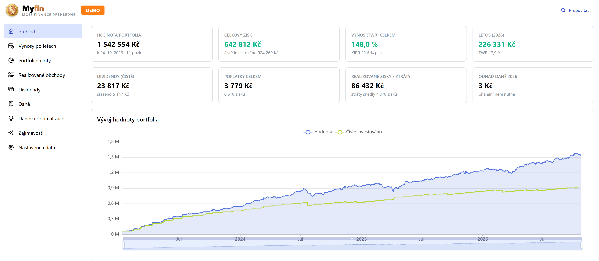

# Myfin – moje finance přehledně

Lokální aplikace pro přehled investic a daní z exportů brokerů **Degiro** a **XTB**.



- Výnosy po letech v % (TWR, MWR/XIRR) i v Kč a jejich struktura: realizované a nerealizované zisky, dividendy, srážková daň, úroky a poplatky.
- Portfolio a nákupní loty (FIFO), postup k časovému testu 3 roky.
- Realizované obchody: zisk/ztráta, poplatky, doba držení a daňový status prodeje (časový test, limit 100 000 Kč, zdanitelné).
- **Daňové přiznání – §10 (cenné papíry):** Příloha č. 2 (tabulka druh D, ř. 207–209 → ř. 40) připravená ke kopírování. Hlídá limit 100 000 Kč, časový test, oznámení osvobozených příjmů nad 5 mil. Kč (§38v) a nabízí volbu jednotný/denní kurz pro každý rok.
- **Dividendy (§8):** sražená daň, zápočet v ČR a částka, kterou lze vymáhat zpět v zahraničí (podle smluv o zamezení dvojího zdanění, včetně postupu pro jednotlivé státy). Pro každý rok volba: samostatný základ §16a (Příloha č. 4, ř. 401a–414 → ř. 74a), nebo obecný základ (ř. 38 + Příloha č. 3 pro každý stát). Aplikace odhadne, která varianta je výhodnější.
- Tipy k daňové optimalizaci: tax-loss harvesting, limit 100 000 Kč, blížící se časové testy, vratky sražené daně.
- Zajímavosti za celý investiční horizont nebo za zvolený rok: kolik zisku snědly ztráty, ušlý potenciál prodaných akcií (absolutně i po zohlednění reinvestice výnosu z prodeje do portfolia), nejlepší a nejhorší obchody.
- Všechny větší tabulky lze řadit podle sloupců, prohledávat a u vybraných sloupců filtrovat.

Daňovou situaci (OSVČ, OSVČ v paušálním režimu, zaměstnanec, bez jiných příjmů), jiný základ daně, zdanění dividend a přepočet měn lze nastavit zvlášť pro každý rok přímo v sekci **Daně**. Tabulka **Porovnání variant** ukazuje odhad daně pro každou kombinaci kurzu a zdanění dividend a označí nejvýhodnější.

Tlačítko **Stáhnout podklady (Excel)** v sekci Daně vytvoří pro zvolený rok sešit, který ukazuje, jak aplikace k částkám došla (např. pro kontrolu nebo dotaz finančního úřadu). Výpočty jsou v něm uvedeny jako vzorce Excelu, takže je lze dohledat buňku po buňce:

- **Souhrn** – zvolené nastavení a výpočet ř. 207–209 a Přílohy č. 4 ze součtů podrobných listů,
- **Prodeje CP** – každý prodej rozdělený na nakoupené loty (FIFO): kurzy, příjem, výdaje, poplatky, časový test a daňové zařazení,
- **Dividendy** (a **Úroky**) – hrubá částka, sražená daň, smluvní sazba a započitatelná daň, souhrn podle států,
- **Kurzy** – všechny použité kurzy a jejich zdroj,
- **DAP** – hodnoty do přiznání tak, jak je ukazuje aplikace.

Soubor obsahuje vaše finanční údaje – sdílejte ho jen s tím, komu ho chcete ukázat.
> ⚠️ Aplikace je pomůcka, ne daňové poradenství. Před podáním přiznání si výsledky ověřte.

## Spuštění

Potřebujete [Node.js](https://nodejs.org) 22 nebo novější (na macOS např. `brew install node`).

1. Spusťte aplikaci:
   - **Windows:** `start.bat`
   - **macOS:** dvojklik na `start.command` ve Finderu, nebo v Terminálu `./start.sh`

   Při prvním spuštění se nainstalují závislosti, pak se aplikace sestaví a otevře v prohlížeči na <http://127.0.0.1:5174>.
2. V sekci **Nastavení a data** nahrajte exporty nebo je vložte do složky `exports/`.

Pokud macOS při prvním dvojkliku na `start.command` hlásí, že jej nelze otevřít, klikněte na soubor pravým tlačítkem a zvolte **Otevřít**. Chybí-li souboru právo ke spuštění (např. po stažení ZIP z GitHubu), spusťte jednou `chmod +x start.sh start.command`.

### Desktopová aplikace (Electron)

```bash
npm run electron     # sestaví a spustí v okně aplikace
npm run dist:win     # Windows: instalátor dist-electron\Myfin Setup 1.0.0.exe
npm run dist:mac     # macOS: dist-electron/Myfin-1.0.0-mac-arm64.dmg a -x64.dmg (+ .zip)
```

Instalátor pro macOS lze sestavit jen na Macu. Aplikace není podepsaná, proto ji při prvním spuštění otevřete pravým tlačítkem → **Otevřít** (případně povolte v *Nastavení systému → Soukromí a zabezpečení*).

Nainstalovaná aplikace ukládá exporty, nastavení a cache do `%APPDATA%\myfin` (Windows) nebo `~/Library/Application Support/myfin` (macOS), vždy v podsložkách `exports` a `data`.

### Exporty

| Broker | Co exportovat |
| ------ | ------------- |
| Degiro | *Transakce* (`Transactions.csv`) a *Výpis z účtu* (`Account.csv`), vždy za **celé období** od založení účtu |
| XTB    | *Historie účtu* – export `.zip` (nebo `.xlsx`) za celé období |

Nový export stejného typu nahradí předchozí. Starý se přesune do `exports/_archiv`.

### Demo data

Aplikace obsahuje ukázkové exporty ve složce `demo/`: smyšlené portfolio u Degiro (EUR) a XTB (CZK) od roku 2023. Obchody jsou na skutečných instrumentech (Apple, NVIDIA včetně splitu 10:1, ČEZ, Komerční banka, ETF VWCE…) za skutečné historické ceny. Obsahují dividendy z několika zemí, prodeje před časovým testem i po něm a ztrátový prodej.

- Přepnutí: **Nastavení a data → Zdroj dat → Demo data** (nebo tlačítko na Přehledu, dokud nemáte nahrané exporty). V hlavičce se pak zobrazí štítek **DEMO**.
- Demo režim má vlastní nastavení (`data/settings.demo.json`), takže se v něm neukáží vaše osobní údaje a vaše nastavení zůstane beze změny. Nahrané exporty se vždy uloží mezi vaše vlastní.
- Přegenerování (stáhne aktuální ceny z Yahoo Finance): `npm run demo:generate [YYYY-MM-DD]`.

## Soukromí

- Všechna data zůstávají v počítači, ve složkách `exports/` a `data/` (u nainstalované aplikace v `%APPDATA%\myfin`, na macOS v `~/Library/Application Support/myfin`). Obě složky jsou v `.gitignore`.
- Server poslouchá jen na `127.0.0.1`.
- Z internetu se stahují pouze kurzy ČNB a historické ceny z Yahoo Finance; posílají se jen ISIN, tickery a názvy instrumentů.

## Metodika (stručně)

- **FIFO** po brokerech. Splity, výměny (fúze, změny ISIN) i připsané akcie zachovávají datum nabytí. Akcie připsané zdarma mají pořizovací cenu 0.
- **Časový test** (§4/1/u): prodej je osvobozen, pokud doba držení přesáhne 3 roky. Limit osvobození 40 mil. Kč se u cenných papírů uplatní jen za rok 2025 (nad limit se daní poměrná část příjmů i výdajů).
- **Limit 100 000 Kč** (§4/1/t): počítají se hrubé příjmy z prodejů, které nejsou osvobozené časovým testem.
- **Kurzy**: jednotný kurz podle GFŘ (vestavěné oficiální hodnoty 2020–2025), jinak průměr kurzů ČNB k posledním dnům měsíců. Lze jej přepsat ručně nebo pro daný rok zvolit denní kurz (v rámci roku vždy jednotně). XTB obchody v CZK účtu používají skutečnou částku v Kč.
- **Výdaje** = pořizovací cena + poplatky při nákupu i prodeji (transakční poplatky, AutoFX, transakční daně). Ztráta z prodejů CP se uplatní jen proti ziskům z CP v témže roce.
- **Dividendy**: zápočet je nejvýše min(sražená daň, sazba dle smlouvy, 15 % z hrubé dividendy); v obecném základu navíc omezen koeficientem z Přílohy č. 3. Přeplatek nad smluvní sazbu lze reklamovat u zahraničního správce daně. České dividendy a úroky XTB jsou zdaněny srážkou konečně.
- **Povinnost podat přiznání**: OSVČ vždy; zaměstnanec při jiných příjmech nad 20 000 Kč; paušální režim při příjmech §8–§10 nad 50 000 Kč; bez jiných příjmů při zdanitelných příjmech nad 50 000 Kč.
- **Výkonnost**: TWR z denního ocenění (denní řetězení, nákupy na začátku dne, prodeje a příjmy na konci), MWR (XIRR). Tržní ceny z Yahoo Finance; když chybí, použije se poslední obchodní cena (nebo ocenění brokera). Instrumenty bez tržních dat aplikace hlásí na Přehledu a v Nastavení (stav symbolu, filtr), odhadnuté ceny označuje „≈“.
- **Vysvětlení metrik**: každá metrika, graf a číselný sloupec tabulky má u sebe ikonu ⓘ s přesnou definicí (vzorec a použitý kurz). Texty jsou na jednom místě v `src/web/glossary.ts`.

## Vývoj

```bash
npm install
npm run dev        # API (tsx watch) + Vite dev server na http://localhost:5173
npm test           # Vitest (syntetická data)
npm run typecheck
npm run build && npm start
```

Struktura:

- `src/core` – parsery, FX, FIFO, daňové výpočty a analytika (čisté funkce)
- `src/server` – Fastify API, cache ČNB a Yahoo, orchestrace
- `src/web` – React + Mantine + ECharts
- `tests` – testy pouze se smyšlenými daty

## Licence

Copyright © 2026 cepakst

Aplikace je svobodný software pod licencí [GNU Affero General Public License v3.0](LICENSE) (AGPL-3.0-or-later), verze 3 nebo (podle vaší volby) kterékoli pozdější verze. Můžete ji používat, upravovat a šířit. Pokud ale šíříte upravenou verzi nebo ji zpřístupníte jiným uživatelům přes síť (např. jako webovou službu), musíte jim poskytnout její zdrojový kód pod stejnou licencí.

Aplikace se poskytuje bez jakékoli záruky. Není daňovým poradenstvím.
